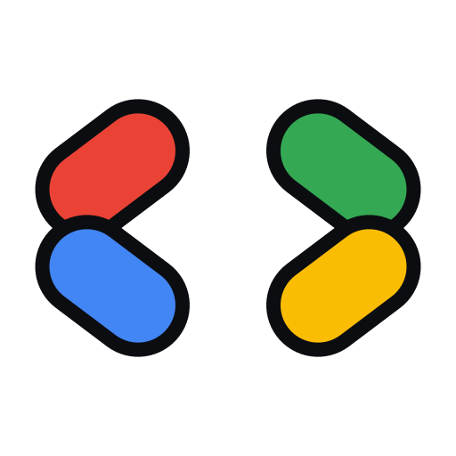

<div align="center">



# GDG on Campus · RVCE

### Stay curious. Build together.

A blueprint-styled home for the **Google Developer Group on Campus** at RV College of Engineering — a student community for workshops, build weekends, and study jams across **AI/ML, Web, Cloud, and Android**.

<br />

[](https://nextjs.org/)
[](https://react.dev/)
[](https://www.typescriptlang.org/)
[](https://tailwindcss.com/)
[](https://pnpm.io/)

</div>

---

## ✨ Overview

This is the official web presence for **GDG on Campus RVCE** — a fast, accessible, statically-exportable site that showcases upcoming and past events, the chapter's focus areas, and the people behind it.

The visual language leans into a **technical "blueprint" aesthetic**: a subtle grid, monospaced annotations, and the four Google brand colors used as accents — set in a bold, modern type system (**Sora** for display, **Plus Jakarta Sans** for body).

> Built to feel like a design system, not a template.

---

## 🚀 Features

- 🎨 **Blueprint design system** — grid backgrounds, hairline borders, and Google's blue / red / yellow / green used sparingly as accents.
- 🌗 **Light & dark themes** — seamless toggle with `next-themes`, no flash on load.
- 🗓️ **Event explorer** — filter by category, format, and status with animated cards and category pills.
- 📄 **Rich event pages** — agenda, speakers, takeaways, venue details, and a registration CTA for every event.
- ⏳ **Live countdown** — an "Up next" block that counts down to the next session.
- 👥 **Team directory** — organized by tier (lead / core / junior / member) and domain, with a sliding member drawer showing bios, skills, repos, and socials.
- 🎞️ **Motion, done right** — tasteful reveal animations via `framer-motion`, respecting `prefers-reduced-motion`.
- 🧱 **Fully static-exportable** — ships as plain HTML/CSS/JS, deployable anywhere.
- ♿ **Accessible by default** — keyboard-friendly, focus-visible rings, semantic landmarks, and a skip-to-content link.

---

## 🧩 Tech Stack

| Layer | Choice |
| --- | --- |
| **Framework** | [Next.js 16](https://nextjs.org/) (App Router, Turbopack) |
| **UI runtime** | [React 19](https://react.dev/) |
| **Language** | [TypeScript](https://www.typescriptlang.org/) |
| **Styling** | [Tailwind CSS v4](https://tailwindcss.com/) |
| **Components** | [shadcn/ui](https://ui.shadcn.com/) + [Base UI](https://base-ui.com/) |
| **Animation** | [Motion](https://motion.dev/) |
| **Icons** | [Lucide](https://lucide.dev/) |
| **Theming** | [next-themes](https://github.com/pacocoursey/next-themes) |
| **Package manager** | [pnpm](https://pnpm.io/) |

---

## 🏁 Getting Started

### Prerequisites

- **Node.js** 18.18+ (20+ recommended)
- **pnpm** (recommended) — `npm i -g pnpm`

### Install & run

```bash
# install dependencies
pnpm install

# start the dev server
pnpm dev
```

Open **http://localhost:3000** in your browser. 🎉

### Build for production

```bash
pnpm build
```

The site is configured for **static export** (`output: 'export'`), so the deployable output lands in the **`out/`** directory — plain HTML, CSS, and JS you can host anywhere.

### Preview the production build

```bash
npx serve out
```

---

## 📁 Project Structure

```
.
├─ app/
│  ├─ layout.tsx              # Root layout, fonts (Sora + Plus Jakarta Sans), metadata
│  ├─ globals.css             # Tailwind theme, design tokens, blueprint utilities
│  ├─ page.tsx                # Home (hero · up-next · interests · featured · recap)
│  ├─ events/
│  │  ├─ page.tsx             # Event explorer with filters
│  │  └─ [slug]/page.tsx      # Individual event detail page
│  └─ team/page.tsx           # Team directory
├─ components/
│  ├─ home/                   # Hero, UpNext, Interests, FeaturedEvents, Recap
│  ├─ events/                 # Event explorer + event card
│  ├─ team/                   # Directory, member card, member drawer
│  ├─ site/                   # Navbar, footer, theme toggle, filter pills, countdown…
│  ├─ blueprint/              # Generated SVG art (events, interests, avatars)
│  ├─ motion/                 # Reveal animation helpers
│  └─ ui/                     # shadcn/base UI primitives
├─ lib/
│  ├─ events.ts               # ⭐ Event content & types
│  ├─ team.ts                 # ⭐ Team members, domains & socials
│  ├─ accent.ts               # Color accent helpers
│  └─ utils.ts                # cn() helper
├─ public/
│  ├─ images/events/          # Event cover images
│  └─ icon.svg                # Favicon / logo (GDG code-braces mark)
└─ next.config.mjs            # Static export config
```

---

## ✏️ Customizing Content

Everything editorial lives in **plain TypeScript data files** — no CMS required.

### Add or edit an event

Edit `lib/events.ts`, then drop a cover image in `public/images/events/`.

```ts
{
  slug: 'build-with-ai',
  title: 'Build with AI.',
  category: 'AI/ML',       // 'AI/ML' | 'Web' | 'Cloud' | 'Android'
  status: 'upcoming',      // 'upcoming' | 'past'
  start: '2026-12-05T10:00:00+05:30',
  accent: 'red',           // 'blue' | 'red' | 'yellow' | 'green'
  // …see the GdgEvent type for the full shape
}
```

### Add or edit a team member

Edit `lib/team.ts`, and (optionally) add a photo to `public/images/team/`.

```ts
{
  slug: 'jane-doe',
  name: 'Jane Doe',
  role: 'Web Lead',
  domain: 'Dev',           // 'Core' | 'Dev' | 'CP' | 'Design' | 'AI/ML' | 'Cloud'
  tier: 'core',            // 'lead' | 'core' | 'junior' | 'member'
  accent: 'green',
  github: 'janedoe',
  linkedin: 'janedoe',
  // …
}
```

### Tweak the theme & fonts

- **Colors, radii, grid tokens:** `app/globals.css` (`:root` and `.dark` blocks)
- **Fonts:** `app/layout.tsx` — swap the `next/font/google` imports and the `--font-*` variables.

---

## ☁️ Deployment

Because the project exports to static HTML, any static host works:

| Platform | How |
| --- | --- |
| **Netlify** | Drag & drop the `out/` folder, or connect the repo |
| **Cloudflare Pages** | Framework preset: Next.js (Static HTML Export) |
| **GitHub Pages** | Publish the `out/` directory to `gh-pages` |
| **Vercel** | Zero-config — just import the repository |

---

## 📜 Scripts

| Command | Description |
| --- | --- |
| `pnpm dev` | Start the development server with Turbopack |
| `pnpm build` | Build and export the production site to `out/` |
| `pnpm start` | Serve the production build locally |

---

## 🤝 Contributing

Contributions from chapter members are welcome!

1. Create a branch: `git checkout -b feat/your-idea`
2. Make your changes and commit: `git commit -m "feat: add …"`
3. Push and open a Pull Request.

Please keep content edits inside `lib/` and images inside `public/images/`, and match the existing design language.

---

<div align="center">

**GDG on Campus · RV College of Engineering** · Bengaluru 🇮🇳

*Stay curious. Build together.*

</div>